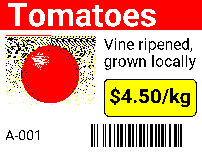
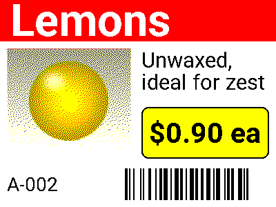
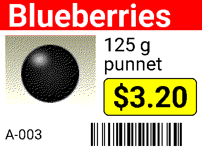
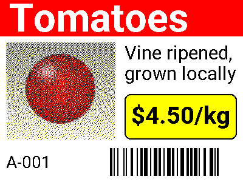

# E-paper shelf tag example

A 400 x 300 px tag for a 4-colour (black, white, yellow, red) e-paper panel,
rendered in-process with Labelable as a library. It uses each colour-display
feature once:

- a `palette` with calibrated `measured_rgb` per ink
- a red `rect` header bar with white text centred by `vertical_align_to_ink`
- an `image` element, dithered to the four inks
- a yellow, outlined, rounded `rect` price badge
- auto-scaled, wrapped text and a Code 128 barcode

| A-001 | A-002 | A-003 |
|-------|-------|-------|
|  |  |  |

## Run it

```bash
uv run examples/epaper/render.py
```

The script installs Labelable from this checkout with no extras, so it also
shows the core install is enough for rendering. On the first run it downloads
Roboto from Google Fonts into `examples/epaper/fonts/` (gitignored).

## Output format

Each PNG is an indexed (mode `P`) image. Its palette indices follow the
template's palette order, so whatever writes the panel can map index to ink
directly:

| Index | Ink |
|-------|-----|
| 0 | black |
| 1 | white |
| 2 | yellow |
| 3 | red |

## Calibration

`measured_rgb` is how each ink really looks on the panel. Dithering matches
photo pixels against those colours, while the PNG keeps the nominal ones. Compare the
calibrated tag with the same tag rendered with nominal colours only:

| Calibrated (`A-001.png`) | Uncalibrated (`A-001-uncalibrated.png`) |
|---|---|
|  |  |

Uncalibrated, the dither believes the red ink is pure `#FF0000`, so it adds
black throughout the tomato to darken it. Calibrated, it knows the panel's red
is already a dark brick colour and keeps the fruit mostly solid red. Text,
barcodes and the bars never dither, so they are identical in both.

The values in `shelf-tag.yaml` are placeholders. To calibrate your panel,
display a solid block of each ink, photograph it under even light, and sample
the colours.

## Sizes in pixels

`dpi: 254` makes 0.1 mm equal 1 px, so `width_mm: 40` is 400 px. `dpi` must
be an integer, so `dpi: 25.4` (1 mm = 1 px) is rejected.
